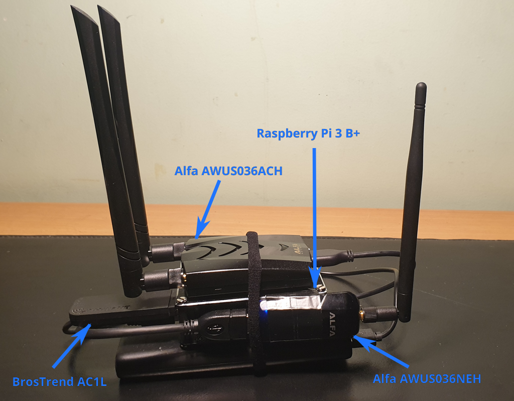
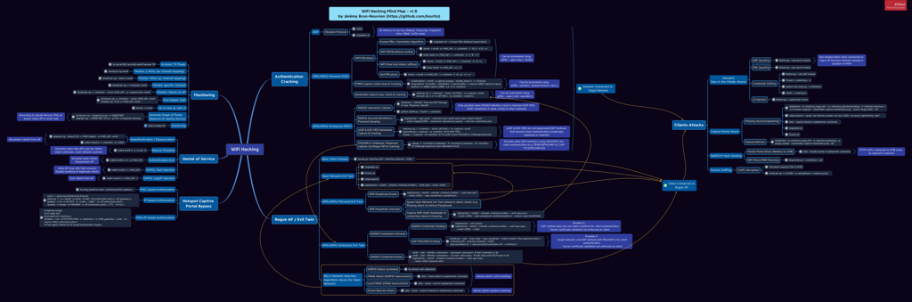

Pi-PwnBox :rocket: -RogueAP :satellite:
===============================================================================

**Homemade (headless) PwnBox / RogueAP based on Raspberry Pi & Alfa WiFi USB Adapters.**

[**WiFi Hacking Cheatsheets & Mind Map :bulb:**](https://github.com/koutto/pi-pwnbox-rogueap/wiki)

Designed to be used for:

- On-site Red Team engagements,
- WiFi Security assessments, 
- WiFi Attacks practice.





Table of Contents
=================

* [Pi-PwnBox-RogueAP](#pi-pwnbox-rogueap)
* [Equipment used](#equipment-used)
* [WiFi USB Adapters Overview](#wifi-usb-adapters-overview)
* [Requirements & Compatibility](#requirements--compatibility)
* [Installation](#installation)
* [PwnBox Network Configuration](#pwnbox-network-configuration)
  * [Wireless Dedicated Administration Network](#wireless-dedicated-administration-network)
  * [LAN Network (Wireless or Wired)](#lan-network-wireless-or-wired)
* [PwnBox Remote Access](#pwnbox-remote-access)
* [Usage](#usage)
* [WiFi Hacking Cheatsheets &amp; Mind Map](#wifi-hacking-cheatsheets--mind-map)
* [Troubleshooting](#troubleshooting)
* [Possible Upgrade](#possible-upgrade)

  

Equipment used
--------------

- [Raspberry Pi 3 Model B+](https://www.raspberrypi.org/products/raspberry-pi-3-model-b-plus), [Pi 4](https://www.raspberrypi.org/products/raspberry-pi-4-model-b) or [Pi 5](https://www.raspberrypi.org/products/raspberry-pi-5)
- Micro SD Memory Card 64 GB (class 10 or better, UHS-I recommended)
- Raspberry Pi Case (with passive/active cooling for Pi 4/5)
- Alfa WiFi USB Adapter [AWUS036NEH](https://www.alfa.com.tw/products_detail/10.htm)
- Alfa WiFi USB Adapter [AWUS036ACH](https://www.alfa.com.tw/products_detail/1.htm)
- BrosTrend WiFi USB Adapter AC1L AC1200 (can be replaced by any adapter supporting AP mode)
- USB cable Male to Female
- Rii Mini Wireless Keyboard (optional)
- Powerbank (minimum 2.5A for Pi 3, 3A+ for Pi 4/5)


WiFi USB Adapters Overview
--------------------------

| Device | Chipset  | Usage | 802.11 | 2.4 Ghz | 5 Ghz | Kali  out-of-box | Mon. Mode | Injec-tion | AP |
|----------|--------|--------|--------|------|-------------------------|--------------|-----------|---------|--------|
| **Built-in Raspberry Pi 3 B+ WiFi chip** | Broadcom 43430 | **Connection to Internet** (auto-start at boot if WiFi key added in config) | 802.11 b/g/n/ac | Y | Y | Y | N* | N* | Y |
| **BrosTrend AC1L AC1200** | Realtek RTL8812AU | **Acces Point for Remote Access** (auto-start at boot) | 802.11 a/b/g/n/ac | Y | Y | N | Y | N | Y |
| **Alfa AWUS036NEH** | Ralink RT2870/3070 | **WiFi Attacks** | 802.11 b/g/n | Y | N | Y | Y | Y | Y |
| **Alfa AWUS036ACH** | Realtek RTL8812AU | **WiFi Attacks** | 802.11 a/b/g/n/ac | Y | Y | Y | Y | Y | Y |

\* would require [nexmon](https://github.com/seemoo-lab/nexmon) patch to enable monitor mode and injection support on built-in Broadcom chip (but we do not need it for its usage here).


Requirements & Compatibility
------------------------------

- **OS:** [Kali Linux ARM](https://www.kali.org/get-kali/#kali-arm) for Raspberry Pi (64-bit recommended for Pi 4/5).
- **Internet:** During installation the PwnBox must have access to the Internet.
- **Root:** Install script must be run as `root`.
- **Note for Pi 4/5:** The 64-bit Kali ARM image is highly recommended. All tools work on `arm64`, but some older precompiled binaries may require `box64` or manual compilation.


Installation
------------

1. Download Kali Linux ARM Image for Raspberry Pi: https://www.kali.org/get-kali/#kali-arm
2. Flash Kali Linux ARM Image for Raspberry Pi onto Micro SD Card (use [Raspberry Pi Imager](https://www.raspberrypi.com/software/) or `dd`).
3. Boot Raspberry Pi, log in (default kali/kali) and make sure it has Internet connection.
4. Download install scripts/configurations on the PwnBox:
   ```bash
   git clone https://github.com/koutto/pi-pwnbox-rogueap.git
   ```
5. **Important:** Edit install script configuration at the top of `scripts/install-system.sh` file:

   - Choose *Guacamole* passwords (`GUACAMOLE_PASSWORD`, `GUACAMOLE_MYSQL_PASSWORD`).
   - Set WiFi interfaces persistent names based on their MAC addresses: `wlxaabbccddeeff` for a device with MAC address `aa:bb:cc:dd:ee:ff`.
   - Set MAC addresses of `eth0` & `wlan0` (built-in interfaces).
   - Set WiFi connection settings (`WIFI_SSID`, `WIFI_PASSPHRASE`).
6. Run install script (will pause at the end of each step in order to allow for manual inspection of command outputs)
   ```bash
   cd pi-pwnbox-rogueap/scripts
   ./install-system.sh
   ```
7. Reboot & check correct configuration of network interfaces:

   ```bash
   ip a
   iwconfig
   ```
   - Built-in wired and wireless interfaces should be named `eth0` and `wlan0` respectively.
   - WiFi USB Adapters should use persistent naming (modern naming convention `wlx*`).
   - AP (`PWNBOX_ADMIN`) should be started on appropriate `wlx*` interface.
8. Configure VNC-over-HTTP on *Guacamole*:
   1. Connect to Guacamole at http://<ip_pwnbox>:8080/guacamole/
   2. Go to *guacadmin (top right) > Settings > Connections*
   3. Click on *New Connection*
   4. Fill connection settings as follows:
      - Name = `pwnbox-vnc`
      - Location = `ROOT`
      - Protocol = `VNC`
      - Maximum number of connections = `3`
      - Maximum number of connections = `3`
      - Guacamole Proxy Hostname = `127.0.0.1`
      - Guacamole Proxy Port = `4822`
      - Network Hostname = `127.0.0.1`
      - Network Port = `5901`
      - Authentication Password = `(password chosen at install when running install-system.sh)`
      - Color depth = `True color (32-bit)`
9. Change default credentials:
   - Kali system credentials (`passwd kali`)
   - Guacamole credentials (via `http://<ip_pwnbox>:8080/guacamole/#/manage/mysql/users/guacadmin`)


## PwnBox Network Configuration

### Wireless Dedicated Administration Network

 When booting, PwnBox automatically spawns an AP on one interface to allow for easy remote access:
- SSID = `PWNBOX_ADMIN` (Hidden SSID)
- WPA2  Passphrase (PSK) = `Koutto!PwnB0x!`
- IP AP = 10.0.0.1 (when connected to this network, PwnBox can be accessed at this IP)
- Network range = 10.0.0.1/24

### LAN Network (Wireless or Wired)

When booting, PwnBox automatically connects to:
- Wired network if Ethernet port is connected.
- WiFi network (using built-in Raspberry Pi chip) if there is available wireless network with saved connection settings (in `/etc/wpa_supplicant.conf`). If you want to connect to a new WiFi network (not saved into PwnBox), it is necessary to add WPA passphrase of the network before:

  1. Access the PwnBox using another way, e.g.:

     - Use wireless dedicated administration network (most convenient approach),
     - Use wired network,
     - Use monitor + (wireless) keyboard.
  2. Add WPA passphrase to PwnBox local configuration:
     ```bash
     wpa_passphrase <SSID> <passphrase> >> /etc/wpa_supplicant.conf
     ```
  3. Test connection:
     ```bash
     wpa_supplicant -B -i wlan0 -c /etc/wpa_supplicant.conf
     dhclient -v wlan0
     ping 8.8.8.8
     ```
     

## PwnBox Remote Access

PwnBox can be controlled through:

- **SSH Service (22/tcp):**

  ```bash
  ssh kali@<ip_pwnbox>
  ```

- **VNC-over-HTTP with Guacamole (8080/tcp):** 

  ```bash
  http://<ip_pwnbox>:8080/guacamole
  ```

**PwnBox's IP** depends on the network you want to access it from:

- Via Wireless Dedicated Administration Network (i.e. connected to hidden SSID `PWNBOX_ADMIN`): IP is always `10.0.0.1`.
- Via LAN Network (wireless or wired): IP depends on the value allocated by DHCP server. IP can be found using `netdiscover` for example.

*Note: Guacamole service might take a lot of resources (RAM) when running. If not used, it can be stopped using `stop-guacamole.sh` script.*


## Usage

- Most of the time, only SSH access is necessary. (CLI tools).
- Additional tools are installed into */usr/share*.
- Tools with GUI or requiring spawning of multiple *xterm* (e.g. *airgeddon*) can be run through *Guacamole*.
- Tools with Web UI (e.g. *Kismet*, *Bettercap*) can be started and accessed remotely.

  

WiFi Hacking Cheatsheets & Mind Map
-----------------------------------------------

- [WiFi Hacking MindMap](mindmap/WiFi-Hacking-MindMap-v1.png) [[PDF version](mindmap/WiFi-Hacking-MindMap-v1.pdf)]

[](mindmap/WiFi-Hacking-MindMap-v1.png)


- [WiFi Hacking Theory Cheatsheets](https://github.com/koutto/pi-pwnbox-rogueap/wiki)
- [WiFi Hacking Commands Cheatsheets](https://github.com/koutto/pi-pwnbox-rogueap/wiki)
- [MitM Commands Cheatsheets](https://github.com/koutto/pi-pwnbox-rogueap/wiki/MitM-Commands)


Troubleshooting
---------------

### Slow boot when Ethernet cable is unplugged
Because `/etc/network/interfaces` uses `auto eth0`, the system waits for a DHCP lease during boot. If you frequently run the PwnBox without Ethernet and experience slow boots, edit `/etc/network/interfaces` and change:
```bash
auto eth0
allow-hotplug eth0
```
to:
```bash
allow-hotplug eth0
```
(Remove the `auto eth0` line.)

### DHCP service conflict warning
`isc-dhcp-server` is installed because some tools (e.g., Fluxion) require it, but it is **disabled by default** to avoid a port 67/udp conflict with `dnsmasq` (which serves the `PWNBOX_ADMIN` AP). If you need `isc-dhcp-server`, stop `dnsmasq` first:
```bash
systemctl stop dnsmasq
systemctl start isc-dhcp-server
```

### Guacamole / Tomcat service fails to start
Newer Kali/Debian releases ship **Tomcat 10** instead of Tomcat 9. The `start-guacamole.sh` and `stop-guacamole.sh` scripts auto-detect the installed Tomcat version. If Guacamole does not work after install, check:
```bash
systemctl list-unit-files | grep tomcat
systemctl status guacd
systemctl status mysql
# Then start manually with correct tomcat version, e.g.:
systemctl start tomcat10
```

### BrosTrend AC1L driver issues
If the vendor installer (`deb.trendtechcn.com`) is offline, build the driver manually:
```bash
sudo apt-get install -y bc git build-essential dkms
sudo git clone https://github.com/cilynx/rtl88x2bu.git /usr/src/rtl88x2bu-5.8.7
sudo dkms add -m rtl88x2bu -v 5.8.7
sudo dkms autoinstall
```

### VNC server does not start
Make sure you ran `vncpasswd` during install to create the password file:
```bash
vncpasswd
systemctl restart vncserver
```

### Python 2 tools no longer work
Python 2 has been removed from modern Kali. The install script now uses **Python 3 only**. If you have old custom Python 2 tools, migrate them to Python 3 or run them in a dedicated Docker container.

### No Internet after disabling NetworkManager
The install script disables NetworkManager in favor of classic `/etc/network/interfaces`. If you need to temporarily re-enable NM:
```bash
systemctl start NetworkManager
systemctl enable NetworkManager
```

### Wireless interface names changed after reboot
Check that your MAC addresses in `install-system.sh` match reality:
```bash
ip link show
```
Then re-run the network configuration section or update `/etc/udev/rules.d/70-persistent-net.rules` manually.

### Reverse shell / C2 session over 4G drops when plugging in Ethernet
When the PwnBox reaches the Internet through a 4G USB dongle (e.g. `eth1`) and you run `dhclient eth0` after plugging in a network cable, the new DHCP lease installs a **second default route via `eth0`**. Because both default routes share the same metric, the kernel may start sending traffic out `eth0` with the wrong source address, which breaks the established reverse shell routed over 4G (see issue [#7](https://github.com/koutto/pi-pwnbox-rogueap/issues/7)).

The fix is to make sure the 4G interface keeps the **preferred (lowest-metric) default route**, so pulling a lease on `eth0` does not take over the default gateway.

**Option A — give `eth0` a higher route metric when requesting a lease** (keeps 4G as default, `eth0` still usable):
```bash
# Lower metric = higher priority. 4G stays default (e.g. metric 100), eth0 is lower priority.
dhclient -e IF_METRIC=200 eth0
```
To make it persistent, set the metric in `/etc/network/interfaces`:
```bash
iface eth0 inet dhcp
  metric 200
```
and ensure the 4G dongle interface uses a lower metric (e.g. `metric 100`).

**Option B — get an IP on `eth0` without touching the default route** (use `eth0` only for the local LAN):
```bash
# Request an address but no default gateway from the eth0 DHCP server
dhclient -e IF_METRIC=1000 eth0
# or, persistently, drop "routers" from the dhclient request for eth0 in
# /etc/dhcp/dhclient.conf (interface "eth0" { request subnet-mask, broadcast-address; })
```

Verify which default route is active:
```bash
ip route show default
```


Possible Upgrade
----------------

- Add 4G USB dongle for remote access to PwnBox using 4G cell network.
- Replace BrosTrend AC1L with a dual-band AP-capable adapter supporting 802.11ax (WiFi 6) for better performance.
- Add GPS USB module for wardriving with Kismet.
